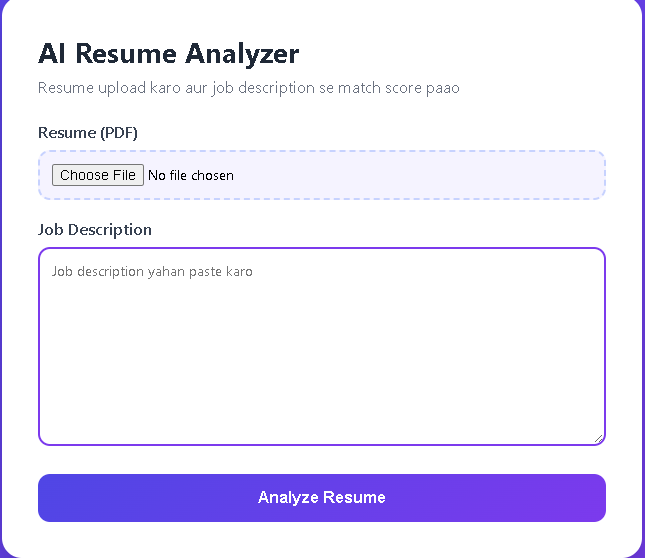
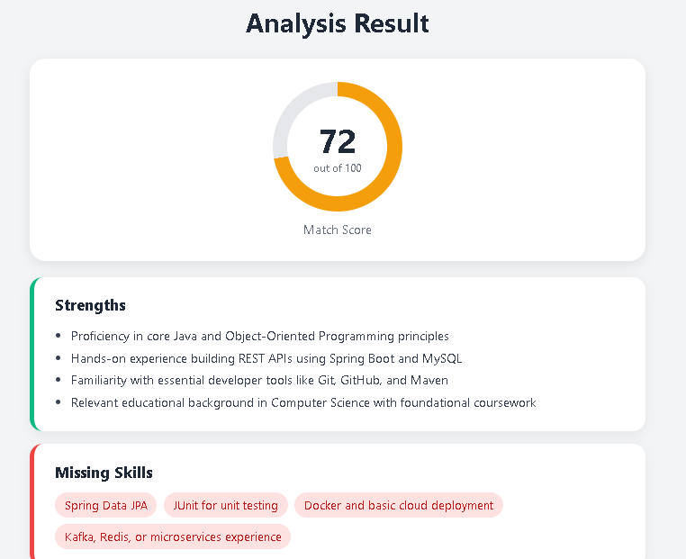
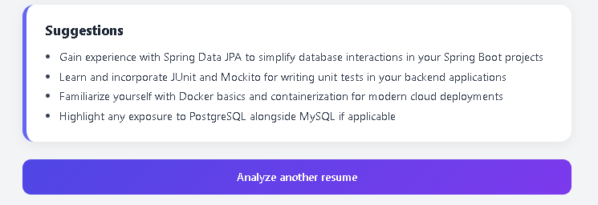

# AI Resume Analyzer

A web app that compares a resume (PDF) with a job description and uses AI to give a match score, strengths, missing skills and improvement suggestions.

Built with **Java 21, Spring Boot 4 and the Google Gemini API**.

## Screenshots

**Upload page**



**Analysis result**





## Features

- Upload a resume as a PDF and paste any job description
- Text extraction from the PDF using Apache PDFBox
- AI analysis returned as structured JSON and parsed into a Java object
- Match score (0-100) with a color-coded score ring
- Strengths, missing skills and actionable suggestions
- Retry logic and timeouts for network and server errors

## Tech Stack

- Java 21
- Spring Boot 4 (Spring Web MVC, RestClient)
- Thymeleaf
- Apache PDFBox
- Google Gemini API
- Maven

## How It Works

1. The user uploads a PDF resume and pastes a job description.
2. `PdfParserService` extracts the text from the PDF.
3. `AiClientService` sends both texts to the Gemini API with a prompt that asks for JSON only.
4. The JSON response is parsed into an `AnalysisResult` object.
5. The result page shows the score, strengths, missing skills and suggestions.

## Run Locally

1. Install **JDK 21 or newer**.
2. Get a free API key from [Google AI Studio](https://aistudio.google.com/apikey).
3. Set the key as an environment variable (never commit it):

```powershell
   $env:GEMINI_API_KEY="your_key_here"
```

   On Mac/Linux:

```bash
   export GEMINI_API_KEY=your_key_here
```

4. Start the app:

```bash
   ./mvnw spring-boot:run
```

   On Windows: `.\mvnw.cmd spring-boot:run`

5. Open `http://localhost:8080`.

## Project Structure

```
src/main/java/com/yusra/resumeanalyzer/
├── controller/   ResumeController
├── service/      PdfParserService, AiClientService
├── model/        AnalysisResult
└── ResumeAnalyzerApplication
```

## What I Learned

- Integrating an external AI API into a Spring Boot app
- Getting structured JSON output from an LLM and parsing it safely
- Handling file uploads and PDF parsing
- Debugging real-world issues like deprecated models, 503 errors and connection resets
- Keeping secrets out of source code with environment variables

## Future Improvements

- Save analysis history in PostgreSQL
- Docker support and cloud deployment
- Rewrite resume bullet points with AI
- Downloadable PDF report